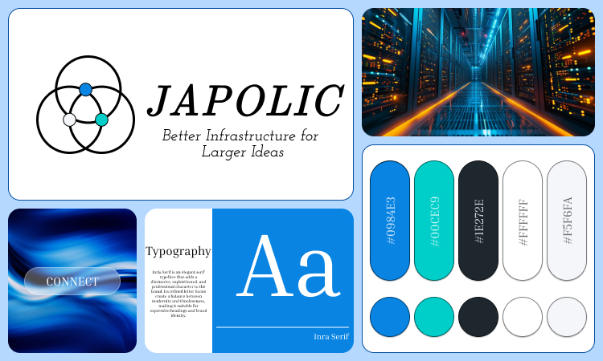
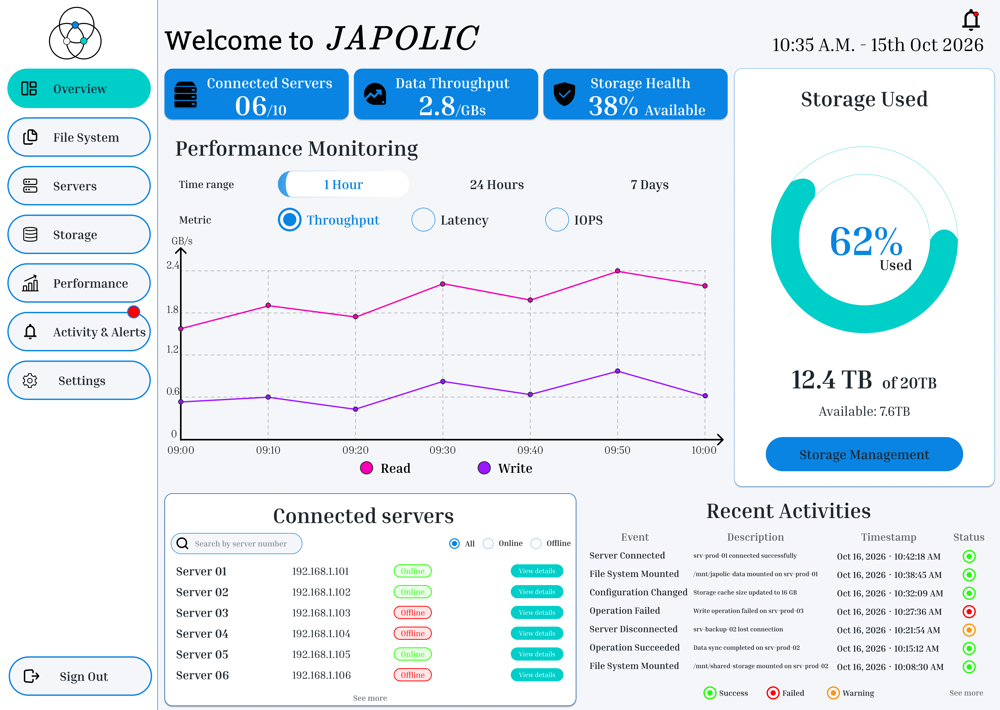
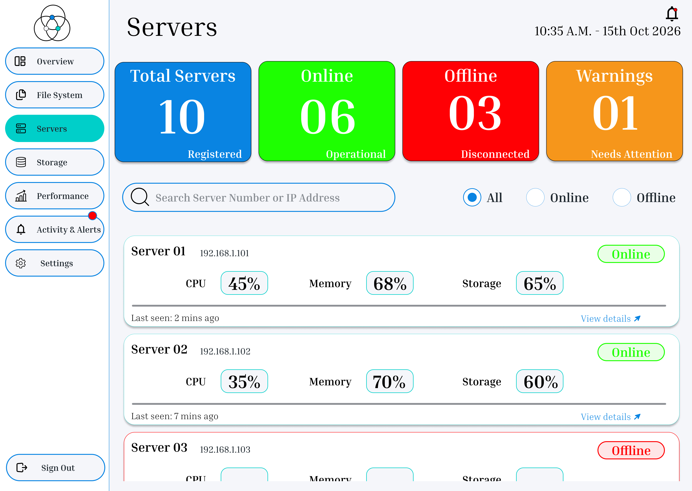

# Japolic – Product Design & Infrastructure Management Dashboard

A product design project focused on a developer infrastructure platform that provides high-performance shared storage for multiple servers.

This project explores how brand identity, visual design, and user interface design can work together to create a clear and professional experience for technical users.

## 📌 Project Overview

Japolic focuses on infrastructure management, enabling technical users to monitor storage usage, connected servers, system health, and performance metrics.

The project involved developing a visual identity and designing two key product screens: an infrastructure monitoring dashboard and a server management interface.

## 🎯 Project Objectives

- Develop a visual identity that reflects the technical nature of the product.
- Establish a consistent visual direction through a moodboard and color palette.
- Design a dashboard that presents infrastructure metrics clearly.
- Create a server management interface with structured information and clear visual hierarchy.
- Explore product design principles for a technical audience.

## 🎨 Moodboard & Visual Identity

The moodboard establishes the visual direction of the Japolic brand, bringing together typography, colors, and visual references to create a consistent design language.

### Logo Inspiration

The logo uses a geometric symbol inspired by the structured and interconnected nature of developer infrastructure. The goal was to create a clean, modern, and technical visual identity.

### Color Palette

The color palette combines dark blue, sea blue, and white.

- **Dark Blue:** Communicates stability, professionalism, and reliability.
- **Sea Blue:** Adds a modern feel while supporting visual distinction.
- **White:** Creates clarity, balance, and visual breathing space.

Blue is commonly associated with trust and reliability, making it a suitable choice for an infrastructure-focused product.

## 📊 Primary Screen – Infrastructure Dashboard

The primary dashboard provides a centralized overview of the infrastructure, helping technical users understand system status and performance at a glance.

### Key Features

- **Storage Overview:** Displays total storage usage and capacity.
- **Connected Servers:** Provides a summary of connected infrastructure.
- **Data Throughput:** Highlights data transfer performance.
- **Storage Health:** Presents storage availability and health information.
- **Performance Monitoring:** Visualizes read/write throughput, latency, and IOPS.
- **Recent Activity:** Shows important system events and activity updates.

The design focuses on information hierarchy, readability, and presenting technical data in a structured layout.

## 🖥️ Supporting Screen – Server Management

The supporting screen focuses on server management, allowing technical users to review connected servers and access relevant server information.

The interface aims to make technical details easier to scan through organized layouts, clear status indicators, and a consistent visual structure.

## 🛠️ Tools Used

- **Figma** – Interface design, visual exploration, and prototyping.

## 💡 Key Learnings

This project was my first experience exploring product design beyond individual UI screens. It helped me understand the importance of connecting brand identity, visual direction, and interface design within a single product experience.

It was also my first experience creating a moodboard, which helped me establish a visual direction before designing the product interfaces.

## 📁 Project Assets

- `MoodBoard.jpg` – Brand moodboard and visual direction.
- `Primary_Screen.jpg` – Infrastructure monitoring dashboard.
- `Supporting_Screen.jpg` – Server management interface.

## 👩‍💻 Project Focus

Product Design | UX/UI Design | Dashboard Design | Visual Identity | Information Architecture | Data Visualization

---

**Designed with Figma.**
